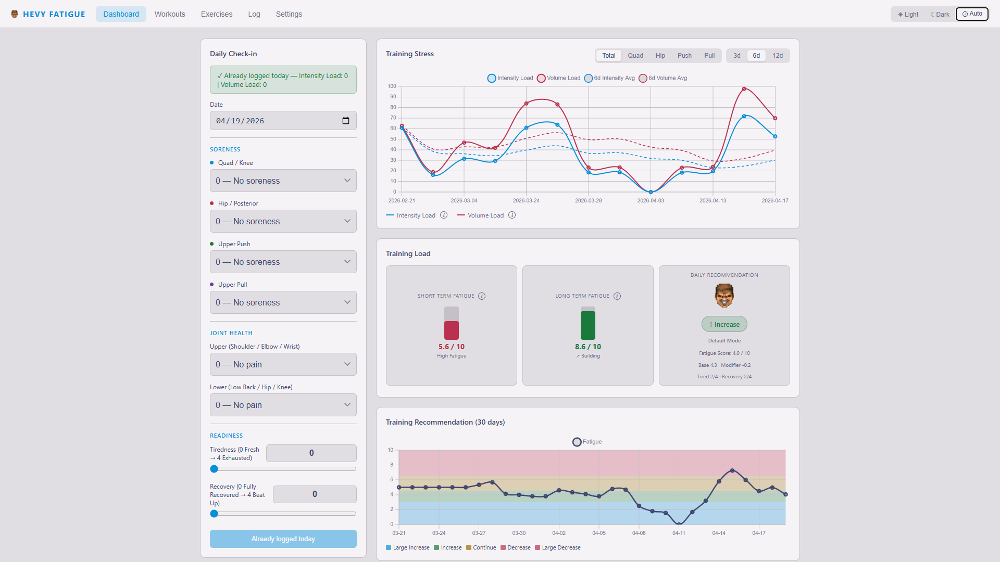
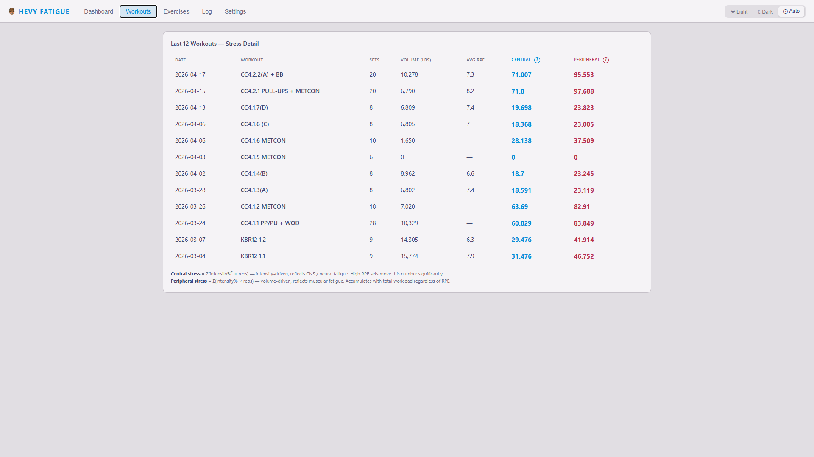
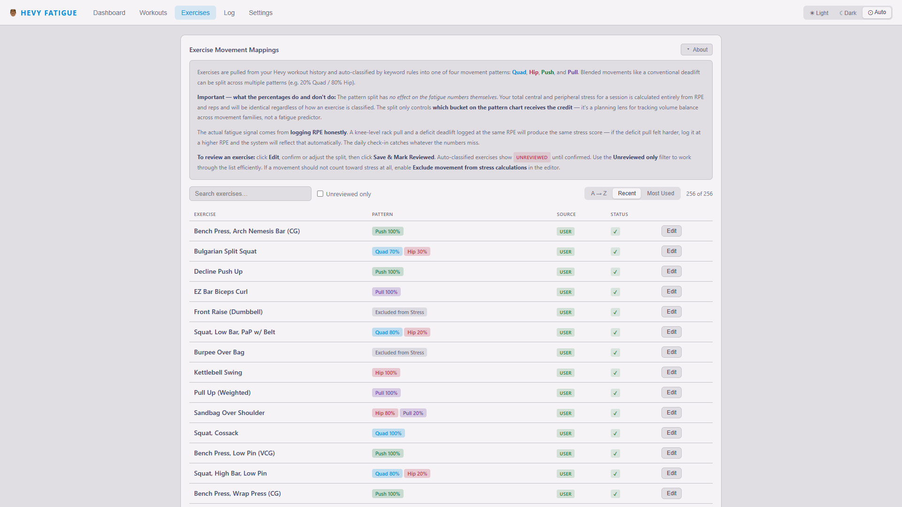
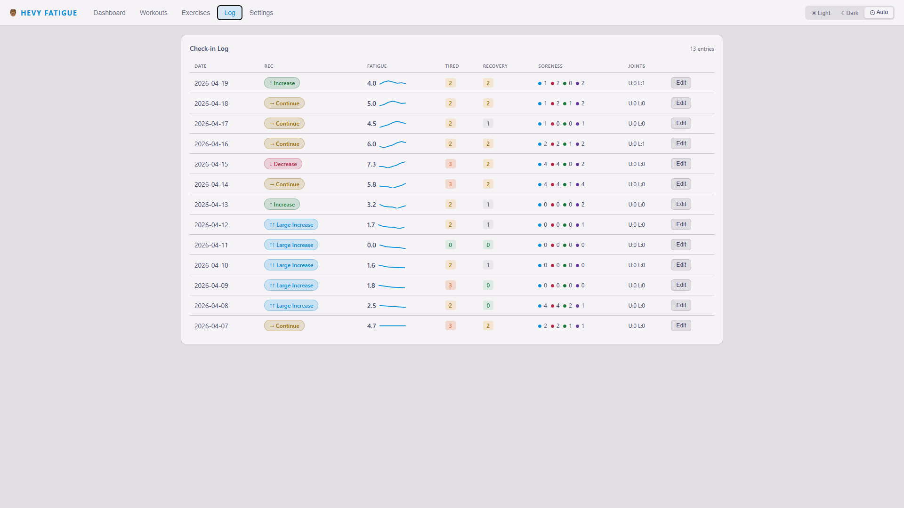
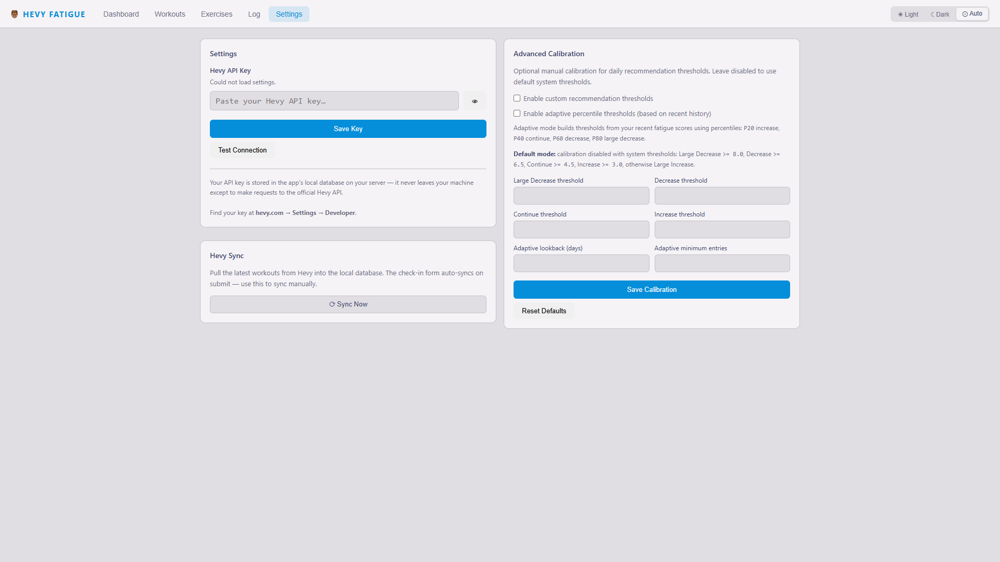

#  Hevy Fatigue

A self-hosted fatigue and training-readiness app for strength athletes using the [Hevy](https://hevy.com) workout logger.

The app pulls workouts from the Hevy API, derives training stress from your logged sets, and combines that with a daily subjective check-in to generate a simple daily recommendation.

> Requires a Hevy PRO subscription for API access.

## What It Does

This app combines two inputs:

- Training stress derived from your Hevy workout history
- A daily subjective check-in that drives the base fatigue score

The current model is subjective-first:

- Your check-in creates the base fatigue score
- The raw combined score is 80% subjective fatigue and 20% recent tonnage relative to your baseline
- The dashboard fatigue trend uses a 0-20 scale and retains recent fatigue as recovery improves

## Current Dashboard Terms

- Short Term Fatigue: your recent loading relative to your own peak history
- Long Term Fatigue: your longer training baseline relative to your own peak history
- Daily Recommendation: the current recommendation bucket based on the fatigue model
- Intensity Load: the intensity-driven stress signal
- Volume Load: the volume-driven stress signal

## Features

- Daily check-in for soreness, joint health, tiredness, and perceived recovery
- Subjective-first fatigue score with training-load modifier
- 30-day recommendation chart based on fatigue score
- Stress chart with Intensity Load and Volume Load history
- Pattern filtering for Quad, Hip, Push, and Pull
- Workout summary and recent-workouts detail views
- Editable exercise mappings with custom movement splits
- Per-exercise exclusion from stress calculations
- Manual sync from Settings plus auto-sync on check-in submission
- Light, dark, and auto theme support
- Mobile-friendly single-page UI
- Optional calibration settings for recommendation thresholds
- Optional adaptive percentile mode based on recent fatigue history

## Screenshots

### Dashboard



### Workouts



### Exercises



### Log



### Settings



## Recommendation Model

The app uses five recommendation buckets:

- Large Increase
- Increase
- Continue
- Decrease
- Large Decrease

The raw score combines 80% subjective fatigue and 20% objective load. Objective
load compares tonnage from the seven completed days before a check-in with the
180-day weekly baseline. Same-day and future workouts are excluded.

When fatigue worsens, it takes effect immediately. When it improves, the fatigue
trend retains 65% of its previous value and incorporates 35% of today's raw score.
Increases require two consecutive check-ins at least 0.5 points below the next
threshold and advance only one recommendation level at a time.

The fixed fatigue bands are `<=6`, `<=8`, `<=13`, `<=14`, and `>14`, from Large
Increase through Large Decrease. Confirmation rules can delay an increase after
the trend crosses a boundary. Legacy/adaptive calibration thresholds do not
control this daily model; pattern sensitivity settings remain separate.

**Continue Training as Normal** is shown with an insufficient-data explanation
when today's check-in is missing/incomplete, the workout baseline is insufficient,
or monitoring is being established. It means follow your existing plan, without
suggesting an increase or reduction based on missing evidence.

Initial monitoring and returns after more than seven days without valid data
require three consecutive complete check-ins. Shorter gaps show the fallback on
missing days and break increase confirmation, but retain established fatigue
memory. Workouts logged during any monitoring break remain in the load baseline.
The initial workout minimum is three training dates with at least 28 days since
the oldest within the 180-day window. These evidence gates are provisional product
rules, not validated recovery timelines. Joint advisories remain separate.

The dashboard, history chart, log, diagnostics and AI snapshot share this model,
versioned as `recovery-confirmation-v1`. No database migration is required.

## Stress Model

The app calculates two training stress signals from your logged Hevy sets:

- Intensity Load: heavier, higher-effort work drives this up faster
- Volume Load: total work accumulated across sets and reps

These are derived from the RPE table and your logged reps, not from arbitrary set counting.

Warm-up sets are excluded.

Exercises marked "Exclude from stress calculations" are also excluded.

## Pattern Stress

The pattern card separates three signals for Knee, Hip, Push and Pull:

- **Load:** recent imported stress with the existing 7/42-day EWMAs. Its relative
  display uses `ATL / (2 × CTL)`, capped at 1, so residual load remains visible
  after ATL falls below CTL. Completed-day training remains included during
  monitoring gaps; today's workouts enter the following morning.
- **Soreness:** your actual 0–4 regional rating, without smoothing or relabeling.
  The labels are None, Mild, Moderate, Significant and Severe.
- **Trend:** the higher of normalized load and observed soreness, with immediate
  rises and gradual recovery (35% current signal, 65% previous trend). A lower
  soreness answer does not instantly erase yesterday's pattern fatigue.

A missing rating is unknown. Load can still display when its baseline is present;
soreness and trend show gaps where appropriate. Trend monitoring needs three
consecutive observations at startup/after gaps over seven days, plus at least
three pattern-loading dates with 28 days since the oldest in the prior 180 days.
The display is descriptive and its parameters are provisional, not measured
physiological recovery rates. Existing pattern sensitivity settings classify the
trend. The implementation is versioned `pattern-recovery-v1`.

## Daily Workflow

1. Open the app
2. Submit your daily check-in
3. The app auto-syncs recent Hevy data before calculating the new entry
4. Review:
  - Short Term Fatigue
  - Long Term Fatigue
  - Daily Recommendation
5. Use the Log tab to review past entries and fatigue trends

## Settings

The Settings tab handles:

- Hevy API key management
- Manual sync
- Advanced calibration

Advanced calibration is optional and off by default.

It supports:

- Custom fixed thresholds
- Adaptive percentile thresholds
- Configurable lookback window
- Configurable minimum entry count before adaptive mode activates

## Exercise Mappings

Exercises are auto-classified into four movement groups:

- Quad
- Hip
- Push
- Pull

You can review and edit mappings in the Exercises tab.

Notes:

- Custom movement splits affect the pattern charts only
- They do not change the total fatigue score directly
- Excluding a movement from stress calculations removes it from stress totals entirely

## Tech Stack

| Layer | Technology |
| --- | --- |
| Backend | Python 3.12, FastAPI, SQLAlchemy |
| Database | SQLite |
| Frontend | Vanilla HTML, CSS, JS, Chart.js |
| Deployment | Docker / Docker Compose |

## Getting Started

### Prerequisites

- Hevy PRO account with API access
- Hevy API key from `hevy.com -> Settings -> Developer`
- Either Python 3.12+ or Docker

## Option 1 - Run Locally

### 1. Clone the repo

```bash
git clone https://github.com/bross84/hevy-fatigue.git
cd hevy-fatigue
```

### 2. Create a virtual environment and install dependencies

```bash
python -m venv .venv

# Windows
.venv\Scripts\activate

# macOS / Linux
source .venv/bin/activate

pip install -r requirements.txt
```

### 3. Start the app

```bash
uvicorn main:app --reload
```

Open:

```text
http://localhost:8000
```

### 4. Add your Hevy API key

Open the Settings tab and save your API key there.

That is now the primary setup flow.

### Optional local fallback

If you prefer not to use the Settings tab locally, the Hevy client still supports:

1. `HEVY_API_KEY_FILE`
2. `HEVY_API_KEY`

It also loads `.env` if present.

## Option 2 - Docker

Docker is the recommended long-running deployment path.

### 1. Clone the repo

```bash
git clone https://github.com/bross84/hevy-fatigue.git
cd hevy-fatigue
```

### 2. Start the container

```bash
docker compose up -d
```

Open:

```text
http://localhost:8125
```

### 3. Add your Hevy API key

Open the Settings tab and save your API key.

The app stores the key encrypted in the app settings table.

### Optional Docker fallback

The app still supports a file-based fallback key at:

```text
/data/hevy_api_key
```

That is useful for advanced deployments, but no longer required for normal setup.

## Updating the App

```bash
docker compose pull
docker compose up -d
```

Your SQLite database lives in the persistent Docker volume and survives rebuilds.

## CLI Importer

If you want to run a one-off import outside the UI:

```bash
python importer.py
```

This is optional. Most users can rely entirely on the in-app sync flow.

## Acknowledgements

The project is heavily inspired by Mike Tuchscherer's RTS / TRAC ideas and broader RPE-based autoregulation concepts.

This app is not an RTS product and does not claim to reproduce TRAC exactly.


## Tests

Install development dependencies and run the regression tests:

```bash
python -m pip install -r requirements-dev.txt
python -m unittest discover -s tests -v
node tests/test_recommendation_ui.cjs
```

Tests use isolated in-memory SQLite databases and do not sync with Hevy.


## Integrated workout logging (Phase 1)

Production's Git-tracked deployment configuration is
[`deploy/production.compose.yml`](deploy/production.compose.yml); it reproduces
the current server settings, including the approved write-enabled state and
immutable release image. The root Compose file remains for development with
writes disabled by default. See [deployment tracking and read-only drift checks](deploy/README.md).

Log Workout and Plans open the full Rackbook workflow inside Hevy-Fatigue at
`/training`. Exact local sets, TS/TM, units, keypad, timers, plate loading,
microcycles, progress and RPE charts remain separate from monitoring's Hevy data.
The Settings tab owns the shared credential; Training settings links to the
optional trial and remaining logging preferences.

Use separate `DB_PATH` and `RACKBOOK_DB_PATH` files. Docker mounts logging data at
`/training-data/rackbook.db`. Workout posting defaults to disabled with
`HEVY_WRITES_ENABLED=0`; enable it only during the controlled production cutover.
The local preview in `tools.preview_app` uses temporary databases and a mocked
Hevy client. See [integration boundaries and verification](docs/training-integration.md)
and [draft transfer, cutover and rollback](docs/training-cutover.md).
